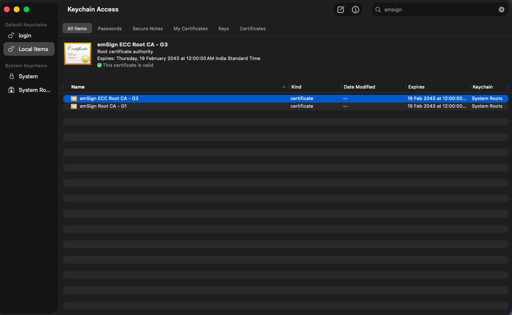
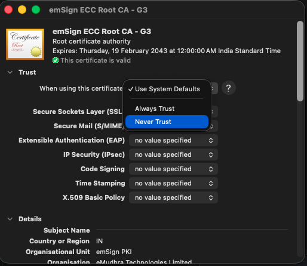
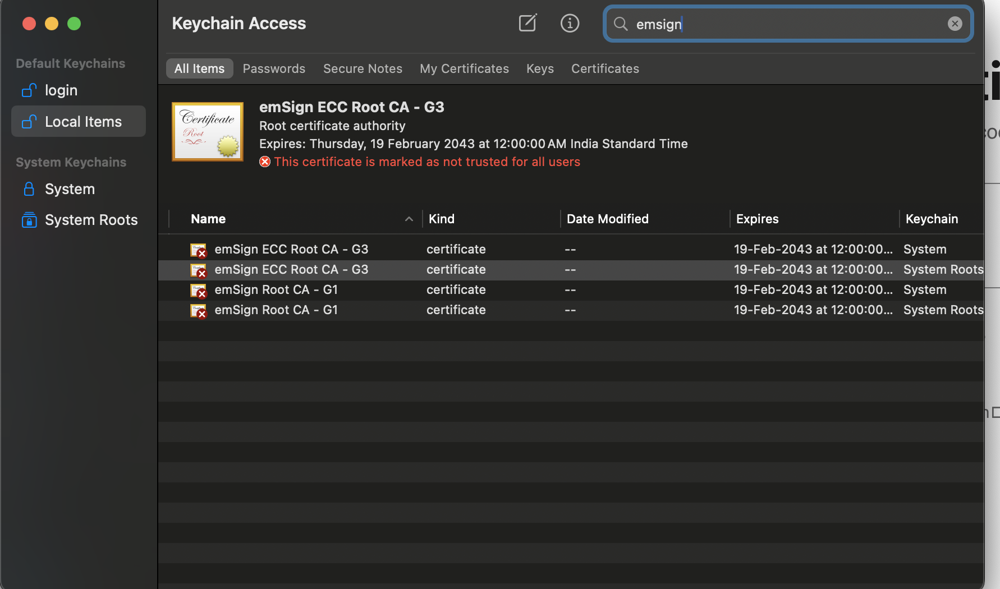

# eMudhra Intermediate CA Compromise: What To Do

## Why this doc exists

- The official page, https://emudhra.we-have-a-problem.com/#check, is the source of truth and gives
  clear guidance. Read it first.
- This doc exists for our users because we wanted a single ordered sequence rather than a reference
  page: first revoke the roots in macOS Keychain, then fix curl, then check each language runtime.
- We also wanted users to **actually probe and confirm** each layer, not just upgrade a language and
  assume it is fixed. Upgrading without validating is how people stay vulnerable. The scripts here
  make you verify by hitting the checker hosts and seeing a real PASS.
- Everything here is built on the knowledge from https://emudhra.we-have-a-problem.com/. We have not
  added any new facts, workarounds, or recommendations. We turned that guidance into a guided,
  step-by-step workflow with built-in verification so our users can act on it with confidence.

## The problem

- Eight eMudhra intermediate CA certificates had their private keys generated incorrectly (back in April 2025).
- Because of the flaw, **anyone can recover those private keys from the public certificates**.
- With a key, an attacker could impersonate any HTTPS website to a client that still trusts these CAs.
- The compromised intermediates chain up to two roots:
  - `AAA Certificate Services` (Comodo)
  - `emSign ECC Root CA - G3` (eMudhra)
- Browsers (Firefox, Chrome, Edge, Safari) are already protected.
- The real gap is **command-line / non-browser tools**: `curl`, `git`, `python3`, `node`, `java`,
  and anything that reads an OS CA bundle or its own bundle without checking revocation.

## How to check what you are affected (trust probes)

The scripts in this directory are **verification tools**. Each one checks whether a specific client
still trusts the compromised eMudhra roots, so you can confirm a fix actually worked instead of
assuming it did. Run the relevant script before and after each step below.

- `check-curl.sh`: checks curl.
- `check-node.sh`: checks Node.
- `check-python.sh`: checks Python (`urllib` and `requests` separately).
- `check-go.sh`: checks Go.
- `check-java.sh`: checks Java.
- `check-all.sh`: runs all of the above and prints a table per tool.

They probe **actual trust**, not version numbers. Different people run different versions, and what
matters is whether a runtime still trusts the two compromised roots.

Each script makes a real HTTPS request to the twelve incident checker hosts using that runtime's own
TLS stack:

- **Certificate error = PASS.** The runtime does NOT trust the compromised roots (safe).
- **Successful connection = FAIL.** The runtime STILL trusts them (vulnerable).
- `SKIP`: runtime not installed, or the result was inconclusive (DNS/timeout).

> **Do not use `curl -k` (or `--insecure`) to test.** `-k` skips certificate validation, so curl
> connects to anything and every host looks reachable. That hides exactly what you are trying to
> detect. Always probe without `-k`; a certificate error is the signal that you are safe. Avoid `-k`
> as a general habit for the same reason.

### How many hosts each probe checks

- By default every script probes all **12** checker hosts: 6 chaining to `emSign Root TLS CA - G3`
  and 6 to `AAA Certificate Services`. This confirms every compromised chain is rejected, matching
  the browser checker.
- For a faster check, pass `--root-only` to probe just **2** hosts, one per compromised root. This
  tells you whether each root is still trusted, without testing every intermediate chain:

  ```sh
  ./check-curl.sh --root-only
  ./check-all.sh --root-only
  ```

- `--all` is the default and can be passed explicitly. Every script (`check-curl.sh`,
  `check-node.sh`, `check-python.sh`, `check-go.sh`, `check-java.sh`, `check-all.sh`) accepts both
  flags.

### Summary of steps

The fixes are five steps. Do Steps 1-4 in order, then Step 5:

- **Step 1, macOS Keychain.** The roots sit in the system Keychain and are trusted there.
  - Set both `emSign ECC Root CA - G3` and `AAA Certificate Services` to **Never Trust**.
  - Covers tools that validate against the macOS system trust store.

- **Steps 2-3, curl and the `/etc/ssl/cert.pem` bundle.** Command-line tools read a PEM bundle,
  not the Keychain, so they can still trust the root after Step 1.
  - Step 2: the `sudo` fix to `/etc/ssl/cert.pem`. Step 3: the `~/.zshrc` env vars.
  - Check both with `check-curl.sh`.

- **Step 4, each language runtime.** A runtime (Node, Go, Java, Python) can ignore both the
  macOS Keychain and the system/Homebrew bundle and ship its **own** trust store.
  - Steps 1-3 do not cover them.
  - Check each language separately and upgrade the ones that still trust the root.

- **Step 5, other runtimes, browser, and OS.** Any other language/runtime with its own trust
  store (Rust, Deno, Bun, .NET, Ruby, etc.), plus browser and macOS updates.
  - Check your own runtime the same way and upgrade it; install browser/OS updates when prompted.
  - Handled by each vendor, so this is **out of scope for this doc**; no commands below.

Each fix section below calls out the specific script to run (curl in Steps 2-3, the per-language
probes in Step 4).

---

## Fix: do these in order

### Step 1: Keychain, confirm the root is trusted, then untrust it

macOS stores the roots in Keychain. Untrust **both** compromised roots there:
`emSign ECC Root CA - G3` and `AAA Certificate Services`. Confirm each is present and trusted, then
set it to **Never Trust**. This is the system-level fix that Keychain-backed tools rely on.

1. Open **Keychain Access**, select **System Roots**, and search `emsign`. You will see
   `emSign ECC Root CA - G3` marked valid/trusted:

   

2. Double-click the certificate, expand **Trust**, and set **When using this certificate** to
   **Never Trust**:

   

3. Close the window (you will be asked to authenticate). The certificate is now shown as
   **not trusted for all users**:

   

4. Repeat steps 1-3 for `AAA Certificate Services`: search `AAA` in System Roots, open it, and set
   **When using this certificate** to **Never Trust**.

> **Both roots must be set to Never Trust.** The compromised eMudhra intermediates are cross-signed,
> so 6 of the 12 compromised chains terminate at `emSign ECC Root CA - G3` and the other 6 at
> `AAA Certificate Services`. Untrusting only one leaves the other half trusted.

### Step 2 (sudo): clean the system file `/etc/ssl/cert.pem`

- Keychain does not fix `/etc/ssl/cert.pem`, which Apple's built-in `curl`/`git`/`python3` read.
- This removes the two roots from that file. It needs `sudo` and backs up to `/etc/ssl/cert.pem.bak`
  first, so it is reversible.

- Run:

  ```sh
  sudo cp -p /etc/ssl/cert.pem /etc/ssl/cert.pem.bak && sudo awk '/^(###|===) /{skip=0} /^=== .*\/CN=(AAA Certificate Services|emSign ECC Root CA - G3)$/{skip=1} !skip' /etc/ssl/cert.pem.bak | sudo tee /etc/ssl/cert.pem > /dev/null
  ```

- Verify the file no longer contains the roots (expect `0`):

  ```sh
  grep -c -e 'AAA Certificate Services' -e 'emSign ECC Root CA - G3' /etc/ssl/cert.pem
  ```

- Roll back if needed:

  ```sh
  sudo cp -p /etc/ssl/cert.pem.bak /etc/ssl/cert.pem
  ```

- Re-check curl (expect `PASS` on all hosts):

  ```sh
  ./check-curl.sh
  ```

### Step 3 (no sudo): redirect tools to Homebrew's clean bundle

- No `sudo` needed; everything under `/opt/homebrew` is owned by your user.
- Points CLI tools at the already-clean Homebrew bundle via environment variables.
- Covers tools (Homebrew curl, Python `requests`, etc.) that read their own bundle rather than
  `/etc/ssl/cert.pem`.

1. (Recommended) update the Homebrew bundle:

   ```sh
   brew upgrade ca-certificates
   ```

2. Confirm the Homebrew bundle is clean (expect `0`):

   ```sh
   grep -c -e 'AAA Certificate Services' -e 'emSign ECC Root CA - G3' /opt/homebrew/etc/ca-certificates/cert.pem
   ```

3. Add these lines to `~/.zshrc`:

   ```sh
   export SSL_CERT_FILE="/opt/homebrew/etc/ca-certificates/cert.pem"
   export CURL_CA_BUNDLE="/opt/homebrew/etc/ca-certificates/cert.pem"
   export REQUESTS_CA_BUNDLE="/opt/homebrew/etc/ca-certificates/cert.pem"
   export NODE_EXTRA_CA_CERTS="/opt/homebrew/etc/ca-certificates/cert.pem"
   ```

4. Reload your shell:

   ```sh
   source ~/.zshrc
   ```

   > The env vars only apply to shells started **after** this change. Any already-open terminal,
   > tmux pane, editor terminal, or long-running process keeps the old (unpatched) environment until
   > you `source ~/.zshrc` in it too. To be sure no stray session is left on the old bundle, **reboot
   > the machine**.

5. In the **same shell**, re-check curl (expect `PASS` on all hosts). If still `FAIL`, confirm
   the exports are set with `echo "$CURL_CA_BUNDLE"`:

   ```sh
   ./check-curl.sh
   ```

What each variable covers:

- `SSL_CERT_FILE`: OpenSSL-linked tools: Homebrew curl, git, Ruby, Perl, PHP, Python `ssl`.
- `CURL_CA_BUNDLE`: curl specifically.
- `REQUESTS_CA_BUNDLE`: Python `requests`.
- `NODE_EXTRA_CA_CERTS`: Node.js (appends; cannot remove a root Node already trusts).

### Step 4: check impacted languages and upgrade them

- A language runtime ships its own trust store and ignores the Keychain and the system/Homebrew
  bundle, so Steps 1-3 do not cover it. Each has its own probe script (all take `-h`):
  - `check-node.sh`: Node `https` stack.
  - `check-python.sh`: Python, reported as `python-urllib` and `python-requests` separately.
  - `check-go.sh`: Go `crypto/tls`.
  - `check-java.sh`: Java `HttpsURLConnection` (uses the JDK `cacerts`).

- Run all probes (including curl); `check-all.sh` exits non-zero if any row is `FAIL`:

  ```sh
  ./check-all.sh
  ```

- Example output. Each runtime is probed against all 12 checker hosts (6 chaining to
  `emSign Root TLS CA - G3`, 6 to `AAA Certificate Services`), so there is one row per host per
  runtime. Abbreviated to one runtime's 12 rows:

  ```
  RUNTIME  HOST                                          RESULT  DETAIL
  -------  --------------------------------------------  ------  ------------------------------------
  curl     dv-g3b-emudhra.we-have-a-problem.com          FAIL    handshake-succeeded-still-trusted
  curl     dv-g3c-emudhra.we-have-a-problem.com          FAIL    handshake-succeeded-still-trusted
  curl     ov-g3b-emudhra.we-have-a-problem.com          FAIL    handshake-succeeded-still-trusted
  curl     ov-g3c-emudhra.we-have-a-problem.com          FAIL    handshake-succeeded-still-trusted
  curl     ev-g3b-emudhra.we-have-a-problem.com          FAIL    handshake-succeeded-still-trusted
  curl     ev-g3c-emudhra.we-have-a-problem.com          FAIL    handshake-succeeded-still-trusted
  curl     dv-g3b-aaa-emudhra.we-have-a-problem.com      FAIL    handshake-succeeded-still-trusted
  curl     dv-g3c-aaa-emudhra.we-have-a-problem.com      FAIL    handshake-succeeded-still-trusted
  curl     ov-g3b-aaa-emudhra.we-have-a-problem.com      FAIL    handshake-succeeded-still-trusted
  curl     ov-g3c-aaa-emudhra.we-have-a-problem.com      FAIL    handshake-succeeded-still-trusted
  curl     ev-g3b-aaa-emudhra.we-have-a-problem.com      FAIL    handshake-succeeded-still-trusted
  curl     ev-g3c-aaa-emudhra.we-have-a-problem.com      FAIL    handshake-succeeded-still-trusted
  ```

  The same 12 rows repeat for `node`, `python-urllib`, `python-requests`, `go`, and `java`.

- Upgrade anything still `FAIL`, then re-run to confirm; a fully fixed machine exits 0 with every
  row `PASS` (or `SKIP` for runtimes you do not have):

  ```sh
  ./check-all.sh
  ```

Reference fixed versions and upgrade commands:

| Runtime | Fixed version | Upgrade |
|---|---|---|
| Node.js | 22.23.4 / 24.22.1 / 26.12.1 | `brew upgrade node` |
| Go | 1.27.3 / 1.26.10 | `brew upgrade go` |
| Java | update the JDK (uses its own `cacerts`) | `brew upgrade openjdk@21` |
| Python `certifi` | 2026.10.19 | `python3 -m pip install --upgrade certifi` |

- The `brew upgrade` commands apply **only if the runtime was installed via Homebrew**. If you
  installed it another way (nvm/fnm, asdf, pyenv, official installer, system package, SDKMAN, etc.),
  upgrade it with that tool instead. The fixed version is what matters, not how you get it.

### Step 5: other runtimes, browser, and OS (out of scope)

- **Check your own language/runtime too.** Step 4 lists Node, Go, Java, and Python only. Any other
  runtime with its **own** trust store (Rust, Deno, Bun, .NET, Ruby, PHP, Erlang/Elixir, etc.) can
  still trust the compromised roots independently.
  - Probe it the same way: make an HTTPS request to `https://dv-g3b-emudhra.we-have-a-problem.com/`
    with that runtime. A certificate error means it is safe, a successful connection means it is
    not. Then upgrade it to a fixed version (see the incident page's patched-version list).
- **Browser and OS updates.** Your browser and macOS may prompt for updates that carry the vendor's
  own revocation data. Install them when prompted.
- These are **out of scope for this doc**, handled by each vendor; there are no commands to run here.
